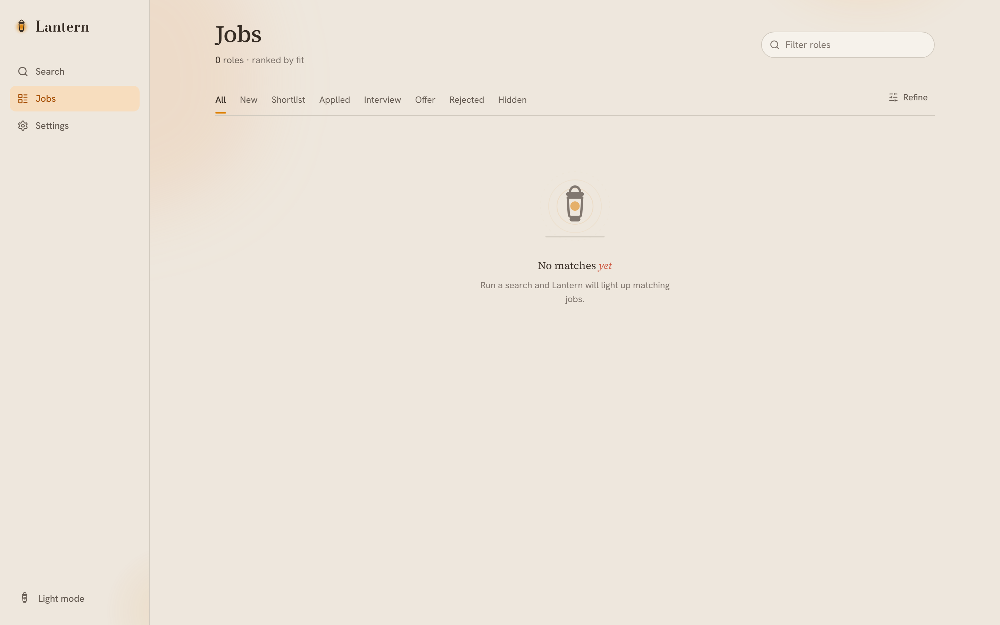
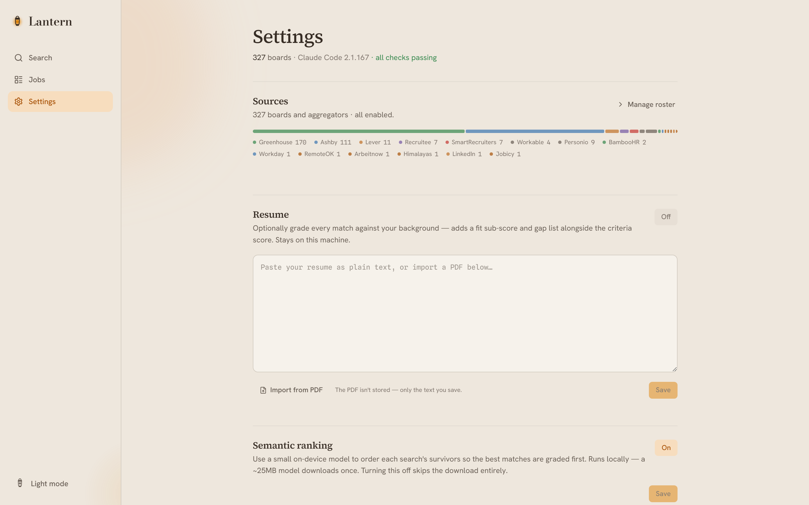
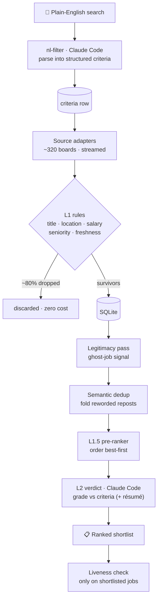

<div align="center">

# 🏮 Lantern

**Type a job in plain English. Get a deduplicated, ghost-filtered, fit-ranked shortlist, all on your own machine.**

Lantern is a local-first job-search harness. One sentence in ("senior backend engineer, remote in Europe, €90k+, no crypto"), a ranked shortlist out. No account, no cloud backend, no data leaving your laptop.

[](LICENSE)
[](https://bun.sh)
[](https://www.typescriptlang.org/)
[](#)

</div>

<div align="center">
  
  
  
  <br/>
  <sub>Search · Jobs · Settings</sub>
</div>

---

## Why Lantern

Most job tooling sits at one of two extremes. Raw scrapers dump a CSV with no ranking, no deduplication, and no signal about whether a posting is even real. Cloud autofill services are closed and paid, and they send your résumé and search history to someone else's server.

Lantern takes the middle seat: **honest, local, and selective.** It reads a large set of public job boards, throws away the noise with cheap deterministic rules, scores what survives against what you actually asked for, and flags postings that look like ghosts. Everything happens on `localhost`. The only thing that leaves your machine is the search text and job descriptions handed to your own Claude Code session for grading.

| | Raw scrapers | Cloud autofill | **Lantern** |
|---|:---:|:---:|:---:|
| Runs locally | ✓ | ✗ | ✓ |
| Deduplicates | ✗ | partial | ✓ (lexical + semantic) |
| Ranks by fit | ✗ | volume-first | ✓ |
| Flags ghost jobs | ✗ | ✗ | ✓ |
| Keeps your data private | ✓ | ✗ | ✓ |
| Open source | ✓ | ✗ | ✓ |

## Highlights

- **Plain-English search.** You never fill in a form. A search sentence is parsed into structured criteria (title, location, salary, seniority, exclusions), and the app shows you exactly how it read your request.
- **Ghost-job signal.** A deterministic scorer rates every posting `high` / `caution` / `suspicious` from age, how long it has stayed open, description quality, reachability, and repost patterns. It shows the reasons behind each rating rather than hiding them behind a number.
- **Two-tier filtering.** Deterministic rules discard roughly 80% of results at zero cost; only the survivors reach the language model, which grades each against your criteria (and, optionally, your résumé).
- **Semantic intelligence, run locally.** A small on-device embedding model reorders survivors best-first, folds reworded reposts, and powers a "similar jobs" view. No GPU, no external API.
- **~320 boards out of the box.** Per-company boards across Greenhouse, Ashby, Lever, Recruitee, SmartRecruiters, Workable, Personio, BambooHR, and Workday, plus keyword aggregators. Every one is a public HTTP API behind an SSRF guard.
- **Yours to keep.** SQLite on disk, a three-page web UI, and no telemetry.

## Quickstart

**Prerequisites**

- [Bun](https://bun.sh) 1.1+
- The [Claude Code](https://claude.com/claude-code) CLI on your `PATH`, signed in. Lantern spawns it to read your search and grade jobs; it is the only external service Lantern talks to.

```bash
git clone https://github.com/noobiethe13/lantern.git
cd lantern
bun install
bun start          # builds the UI and serves on http://localhost:3000
```

Open [localhost:3000](http://localhost:3000), type a role on the Search page, and run a scan. Boards seed themselves on the first run.

For development, `bun run dev` runs the server and the Vite dev server together with hot reload.

## How it works

A single search flows through the pipeline below. Deterministic steps are cheap and run inline; the two language-model steps (parsing and grading) are the only ones that leave the machine, and they go only to your Claude Code session.



Deterministic rules (L1) run while jobs stream in, so most of the corpus is discarded before it ever costs a token. The legitimacy and deduplication passes are pure and local. Only L1 survivors reach the language model, and they are graded in batches to keep cost down. See [docs/architecture.md](docs/architecture.md) for the full walk-through.

## Documentation

| Guide | What's inside |
|---|---|
| [Architecture](docs/architecture.md) | System overview, the scan lifecycle, and how the pieces fit |
| [Sources](docs/sources.md) | The adapter contract, the two source kinds, the SSRF guard, and the board catalog |
| [Filtering & ranking](docs/filtering-and-ranking.md) | L1 rules, L2 grading, seniority and freshness gates |
| [Ghost-job detection](docs/ghost-jobs.md) | The legitimacy scorer, its signals, and how to read the badge |
| [Semantic intelligence](docs/intelligence.md) | Embeddings, the pre-ranker, semantic dedup, résumé fit, similar jobs |
| [Browser tier](docs/browser-tier.md) | The optional, deterministic, opt-in browser engine and why it exists |
| [LLM provider](docs/llm-provider.md) | The Claude Code integration, prompts, and schema validation |
| [Data model](docs/data-model.md) | The SQLite schema, migrations, and settings |
| [Development](docs/development.md) | Project layout, testing, and adding a source |

## Configuration

Everything is configured from the Settings page, with no config files to edit:

- **Sources roster.** Enable or disable boards, add a company board by pasting its careers URL, and watch each source's last-scan status.
- **Semantic ranking.** On by default. The first run downloads a ~25 MB embedding model once; turning it off skips the download entirely.
- **Résumé fit.** Optional. Paste (or import from a PDF) a master résumé to add a "fit vs. your background" sub-score and a gap list alongside the criteria score.
- **Freshness.** Drop postings older than a set window before they reach grading. On by default at 7 days.
- **Model overrides.** Choose which Claude model handles parsing and grading.

## Privacy & scope

Lantern is built for one person on one machine. The server binds to `localhost` only. Your résumé and search history live in a local SQLite file and are never uploaded. The single external dependency is your own Claude Code session, which receives the search text and the job descriptions it grades.

It is not a mass-application bot, and it does not auto-apply. It finds and ranks; you decide and apply.

## Contributing

Contributions are welcome. Start with [CONTRIBUTING.md](CONTRIBUTING.md) for the workflow, and see [docs/development.md](docs/development.md) for the project layout and how to add a source. Security reports go through [SECURITY.md](SECURITY.md).

## License

[MIT](LICENSE) © Debayan Das

<div align="center">
<sub>Built to be honest about what it finds.</sub>
</div>
