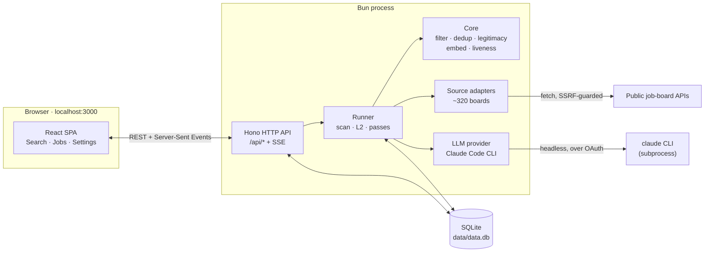
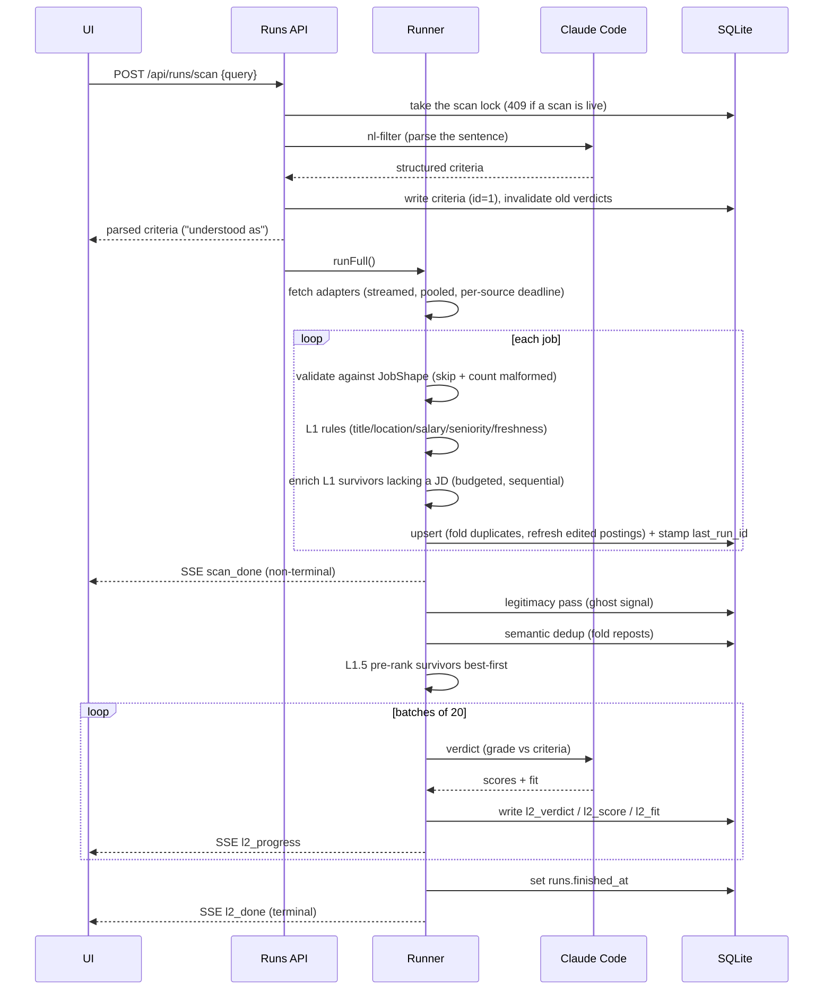

# Architecture

Lantern is a single Bun process. It serves an HTTP API and a built React SPA,
runs scans against a set of job boards, and stores everything in a local SQLite
file. There is no separate worker, queue, or database server.

## Components

The pieces:

- **HTTP API** (`src/server.ts`, `src/routes/*`) is a Hono app on Bun. It exposes
  `/api/*` routes, streams scan progress over Server-Sent Events, and serves the
  built SPA from `ui/dist`. It binds to `localhost` only, and every `/api/*`
  request must carry a localhost `Host` header (a DNS-rebinding defence);
  state-changing requests additionally reject a foreign `Origin` or a
  `Sec-Fetch-Site: cross-site` request. Unknown `/api/*` paths return a JSON 404,
  never the SPA shell.
- **Runner** (`src/runner/*`) orchestrates a scan: fetch, filter, the
  deterministic passes, and language-model grading. Progress is published on an
  in-process event bus.
- **Core** (`src/core/*`) is the pure logic: filtering, deduplication, the ghost
  scorer, embeddings, liveness classification, and the fetch/SSRF layer. Most of
  it has no database dependency, which keeps it unit-testable.
- **Source adapters** (`src/sources/*`), one per board type, each an async
  iterable that streams `Job` objects.
- **LLM provider** (`src/llm/*`) is the single integration point for the language
  model. It spawns the Claude Code CLI in headless mode.
- **Store** (`src/db/*`) is a `bun:sqlite` database with an idempotent schema and
  migrations.

## The scan lifecycle

A search runs through the pipeline below. The two language-model steps (parsing
the query and grading survivors) are the only work that leaves the machine, and
both go to your Claude Code session.

### Two-phase progress

A scan reports progress in two phases, and the distinction matters:

- `scan_done` fires when L1 finishes. It is **non-terminal**, and the SSE stream
  stays open because L2 events are still coming.
- `l2_done` is terminal, and `runs.finished_at` is set only after L2 completes.
  `runL2Pass` writes `finished_at` *before* emitting `l2_done` on every exit path
  (normal, nothing pending, aborted).
- `error` is the other terminal event: if `runFull` throws after the run row
  exists, it records the error in `errors_json`, sets `finished_at`, emits
  `error`, and releases the scan lock.

Marking a run finished at the end of L1 would make the UI look done while the
model is still scoring. The Search page treats a run with `finished_at === null`
as in progress and reconnects to its stream.

### One scan at a time

`POST /api/runs/scan` takes the scan lock *before* the multi-second `nl-filter`
call, so two overlapping searches can't both start a run or rewrite the criteria
under each other; every early exit (bad body, nl-filter failure) releases it, and
`runFull` releases it when the run ends. `createRun` then snapshots the criteria
(YAML, parsed form, and the original search sentence) once, so a later search
can't change the rubric partway through a run. A lock is stale when its recorded
pid is dead (or, with no pid, after an hour). At startup, `recoverInterruptedScans`
clears a dead process's lock and marks its unfinished runs finished with an
"interrupted" error, so a crash never leaves the UI stuck on "Scanning".

### Per-source isolation

Each source runs in its own slot of a 10-wide pool with its own `AbortController`
and an 8-minute deadline covering fetch and enrichment. A board that hangs is
aborted and recorded with `last_status = 'timeout'` and a `source_error` event;
the rest of the scan carries on. Jobs that fail the `JobShape` contract are
skipped and counted in that source's `source_done` message rather than stored.

## Design choices worth knowing

- **Deterministic rules run inline; the model runs in a separate pass.** L1 filters
  while jobs stream in, so most of the corpus never costs a token. Only survivors
  reach L2.
- **Results are scoped to the current search.** Every job a run surfaces is
  stamped with `last_run_id`, and the Jobs API filters and ranks by it. Each
  search shows its own result set, ordered by L2 score.
- **Grading is batched.** Each Claude Code invocation carries a fixed, uncacheable
  cost, so L2 grades 20 jobs per call rather than one. See
  [filtering-and-ranking.md](filtering-and-ranking.md).
- **Deduplication stays linear.** Fuzzy dedup prefilters on an indexed normalized
  company column instead of scanning the whole table, which matters at hundreds of
  boards. Two postings fold only when they are the same role at the same level in
  a compatible location. See [data-model.md](data-model.md).
- **Matching is whole-word.** Criteria terms match as whole words or phrases,
  with a place gazetteer and a remote-eligibility rule for locations. See
  [filtering-and-ranking.md](filtering-and-ranking.md).

## Stack

- **[Bun](https://bun.sh)** provides the runtime, `bun:sqlite`, built-in fetch, and the test runner.
- **[Hono](https://hono.dev)** is the HTTP server, with SSE for progress.
- **[cheerio](https://cheerio.js.org)** handles HTML/XML parsing.
- **[zod](https://zod.dev)** validates every LLM output and adapter contract.
- **Vite + React 19 + Tailwind CSS 4** for the single-page UI.
- **[@huggingface/transformers](https://github.com/huggingface/transformers.js)**
  on the CPU backend, running the local embedding model.
