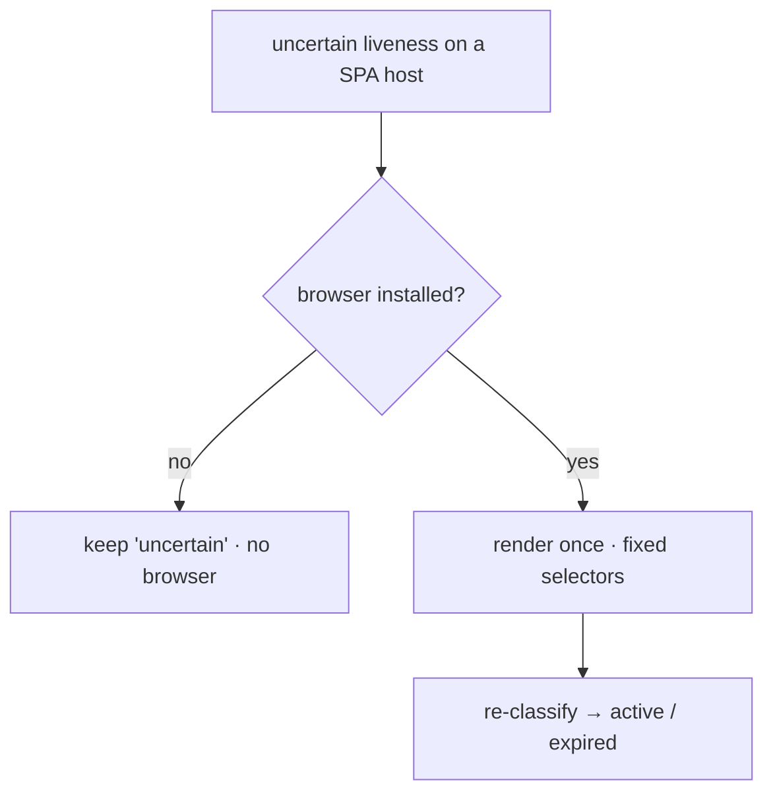

# Liveness & the browser tier

Two related pieces answer the same question ("is this posting still open?") without
a browser in the hot path. Liveness checks run fetch-only on shortlisted jobs. An
optional, deterministic browser tier is the single, carefully scoped exception to
the no-browser default.

## Liveness

Liveness only runs on **shortlisted** jobs, never during a scan, and by default it
is fetch-only: an HTTP request plus cheerio, no browser.

The classifier ([`src/core/liveness.ts`](../src/core/liveness.ts)) is pure. It
strips `nav`, `header`, and `footer` before looking for apply controls and body
text, since navigation "Apply now" links to a careers index were a false-positive
source. It returns one of `active`, `expired`, or `uncertain`. Thin content on a
known single-page-app host classifies as `uncertain` rather than closed, since the
real content renders client-side and a plain fetch cannot see it.

A liveness result feeds directly into the ghost-job score (see
[ghost-jobs.md](ghost-jobs.md)): reachable is a positive, and closed is the strongest
negative.

## The browser tier

Lantern's default fetch path has no browser, and the bulk pipeline never drives
one. The browser tier ([`src/runner/browser.ts`](../src/runner/browser.ts)) is an
**optional dependency that is absent by default**. When it is not installed, every
function degrades gracefully (returning null or false) and nothing breaks.

It exists for a narrow set of opt-in jobs where a plain fetch genuinely cannot see
the page:

- **Liveness fallback.** When a shortlisted job on a single-page-app host reads
  `uncertain`, the engine renders it once and re-classifies.
- **Paste-a-URL extraction** of a job description from an arbitrary posting.
- **Opt-in browser-driven sources** for long-tail boards.



### What keeps it honest

The tier is bound by hard rules, enforced in code and tests:

- **Deterministic only.** Navigate, wait, read fixed selectors. No screenshots or
  DOM are ever sent to a language model. There is no model-driven browsing
  anywhere.
- **SSRF-guarded, including redirects.** The initial URL is checked, and a
  request-time route aborts navigation to any disallowed host, so a redirect
  cannot land on a loopback or metadata address.
- **Ephemeral.** It runs headless, in a throwaway context, and tears down after
  each use.
- **Loaded through one seam.** The engine is named only in `browser.ts` and loaded
  only via a dynamic `import()`. A test (`src/runner/liveness.test.ts`) enforces
  that no other file names or statically imports it, so a default install stays
  browser-free by construction.

### Enabling it

The engine is not installed by default. To turn the tier on:

```bash
bun add patchright && bunx patchright install chromium
```

Until then, liveness stays fetch-only and the browser-driven features are inert.

## Why this is a scoped exception, not a reversal

An earlier version of Lantern carried a headless browser to render arbitrary pages
for a language-model HTML extractor. When that extraction strategy was dropped in
favor of structured public APIs, the browser lost its purpose and was removed. The
binding constraint was always the deterministic, fetch-only identity, not the
browser itself.

The tier here honors that constraint. It adds no model-driven browsing, keeps the
default path fetch-only, and stays out of the bulk pipeline. What it buys is the
handful of cases where honest determinism still needs a rendering engine.
