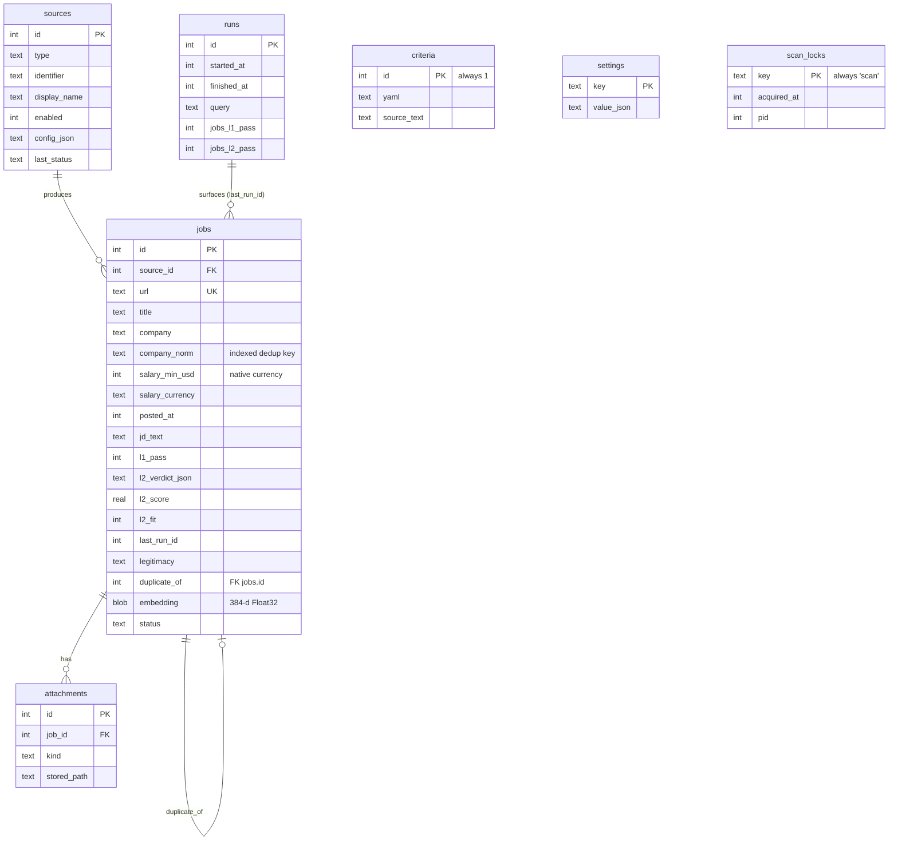

# Data model

Lantern stores everything in one SQLite database at `data/data.db`. The schema
for a fresh database lives in [`src/db/schema.sql`](../src/db/schema.sql);
migrations for existing databases live in [`src/db/migrate.ts`](../src/db/migrate.ts).

> `data/` is user data. It is never edited by hand, and it is gitignored. All
> schema changes go through the migration path.

## Tables

### `jobs`

The central table. A row is created the first time a URL is seen and updated on
every later scan. How an incoming posting lands (`upsertJob` in
`src/runner/scan.ts`):

1. **Same URL.** The row is re-stamped (`last_seen`, `last_run_id`, L1 result).
   If the posting was edited — its `content_hash` (title, location, JD) differs —
   the content columns (title, company, location, remote, salary, JD) are
   refreshed and the derived L2 verdict and embedding are cleared so the job is
   re-graded. A missing incoming JD keeps the stored one and doesn't count as an
   edit. `posted_at`, `first_seen`, and the triage fields (`status`, `notes`,
   `applied_at`) are never touched.
2. **Fuzzy duplicate.** Otherwise, a row with the same `company_norm`, the same
   role (title tokens match, with identical level words: "Senior Engineer" is not
   "Engineer"), and a compatible location (equal, or either side unknown) absorbs
   the posting: its URL is appended to `duplicate_urls` (`shouldFold` in
   `src/core/dedup.ts`).
3. **New row** otherwise.

When a row is hit twice in the same run, a passing L1 result wins over a failing
one, so a passing posting never vanishes into a failing duplicate. An L1 result
left over from an earlier run is replaced, since it was graded under that run's
criteria.

Columns worth calling out:

- **`company_norm`** is the normalized company name (see `normalizeCompany`). It is
  indexed and used as the prefilter for fuzzy deduplication, so an insert only
  compares against same-company rows instead of scanning the whole table.
- **`content_hash`** hashes title, location, and JD; a change on re-scan is what
  triggers the refresh described above.
- **`salary_min_usd` / `salary_max_usd`**. Despite the name, these hold amounts
  in the job's **native** currency, tagged by `salary_currency` (the `_usd`
  suffix is legacy). L1 only compares a salary to a floor when both currencies are
  known and equal.
- **`last_run_id`** is the run that most recently surfaced this job. Results are
  scoped to a search through this column.
- **`l2_score` / `l2_fit`** are denormalized from the verdict JSON so the Jobs API
  can sort and filter without parsing every row.
- **`duplicate_of`** is set by the semantic-dedup pass to the canonical job a
  near-duplicate folds into. Duplicates are kept, not deleted; they are hidden
  from the default list and skipped by L2.
- **`legitimacy` / `legitimacy_reasons`** hold the ghost-job signal and its reasons.
- **`embedding`** is the job's sentence embedding as a raw Float32 BLOB, or NULL
  until embedded (and again after a content refresh). There is no index; it is read by id alongside L2 survivors.
- **`status`** is the triage state (`new`, `shortlist`, `applied`, `interview`,
  `offer`, `rejected`, `hidden`).

### `sources`

One row per board. `enabled` is the user's toggle. The seed sync may turn a
retired per-company board off, but never turns one on; see
[sources.md](sources.md). Deleting a source that has saved jobs, or that is a
seeded default, turns it off instead. `last_status` is `ok`, `timeout` (hit the
per-source deadline), or an error kind (`http-error`, `http`, `gated`, `auth`,
`extract`), with `last_error` holding the message. An `apiKey` in `config_json` is
masked in every API response.

### `runs`

One row per scan. Tracks counts at each stage and the raw query. `finished_at` is
set only after L2 completes. See the two-phase progress note in
[architecture.md](architecture.md).

### `criteria`

A single row (`id = 1`) holding the structured criteria as YAML plus the original
search text. It is a **derived artifact**: the scan endpoint regenerates it from
the natural-language query on every search. There is no criteria editor and no
`/api/criteria` route.

### `settings`

A key-value store (JSON values) for feature settings: the LLM model overrides,
the résumé, the semantic-ranking toggle, and the freshness window. Each has its
own route under `/api/settings/*`.

### `scan_locks`

An advisory lock enforcing one scan at a time. `POST /api/runs/scan` inserts a
row keyed `'scan'` (with the server's pid) before it calls `nl-filter`, and
`runFull` deletes it when the run ends; a concurrent attempt hits the primary-key
conflict and gets a 409. A lock is stale when its pid is no longer alive (or, for
a row with no pid, after an hour) and is then taken over. At startup,
`recoverInterruptedScans` clears a dead process's lock and marks its unfinished
runs finished with an "interrupted" error.

## Migrations

`schema.sql` defines the full schema for a fresh database. `migrate.ts` brings an
existing database up to date with guarded, idempotent statements (`ALTER TABLE
... ADD COLUMN` behind a column check, indexes for migration-added columns).

Two rules keep migrations safe:

- **Keep `schema.sql` comments free of semicolons.** The migration splits the
  file on `;` before stripping comments, so a semicolon inside a comment breaks a
  fresh-database initialization.
- **The `sources.type` CHECK constraint needs both paths.** SQLite cannot alter a
  CHECK, so adding a board type requires editing the constraint in `schema.sql`
  (for fresh databases) *and* a table-rebuild migration (for existing ones).

Migrations are not covered by the test suite. Verify a change by running the
migrations against an in-memory database in three states: fresh, legacy (starting
from an older schema), and idempotent (running twice is a no-op).
