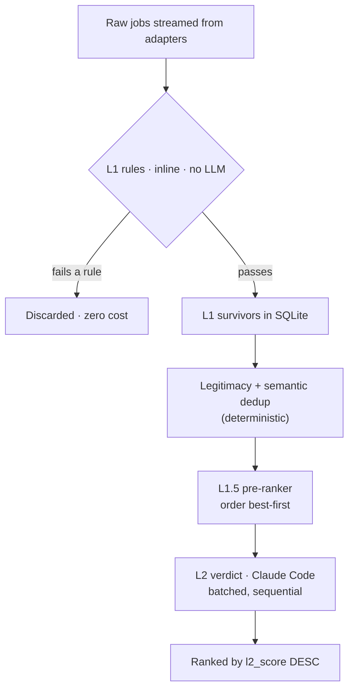

# Filtering & ranking

Lantern narrows a large pool of raw postings to a small ranked shortlist in two
tiers. The first is deterministic and free; the second uses the language model
and is reserved for what rules cannot decide.

## L1: deterministic rules

L1 ([`src/core/filter.ts`](../src/core/filter.ts)) runs on every job as it streams
in and typically discards around 80% of the pool at no cost. A job passes only if
it clears every rule. The rules follow a consistent philosophy: **do not drop what
you cannot evaluate.** Missing data passes and defers to L2.

**Whole-word terms.** Every criteria term (title keywords, location terms,
company excludes) matches as a whole word or phrase, case-insensitively and
ignoring accents, with `-`, `_` and `/` read as spaces (`termMatches` in
`filter.ts`). So `us` does not match "Austin" or "Brussels", `intern` does not
match "International", `java` does not match "JavaScript", and `meta` does not
match "Metabase". Meanwhile `full stack` matches "Full-Stack" and "Fullstack",
and `ci/cd` matches "CI-CD". A term that starts or ends with a symbol keeps
working (`c++`, `c#`, `.net` matches "ASP.NET"). Blank terms are dropped, so an
empty exclude can't exclude every company.

- **Title.** The job title must contain at least one positive keyword and none of
  the negative keywords. Keywords come from the parsed search, expanded with
  synonyms and stack terms.
- **Location.** See [Location and geography](#location-and-geography) below. An
  empty location always passes.
- **Salary floor.** Compared only when the job and the criteria currencies are
  both known and equal (case-insensitive). Lantern does no currency conversion,
  so a mismatch or an unknown currency passes. A range is compared by its top: a
  $140k–$190k posting clears a $150k floor, and only a range entirely below the
  floor fails. A min-only posting is compared by its minimum.
- **Seniority gate.** Engages **only** when the search restricts to junior/mid. It
  drops titles that advertise a senior-or-above level (senior/sr/snr, principal,
  director, VP, head of, distinguished), plus *staff* when it precedes a tech noun
  ("Staff Software Engineer", but not "Staff Accountant"), and ladder rungs III and
  above on SDE, engineer, and developer titles ("SDE-3", "Software Engineer IV";
  "Engineer II" passes). It deliberately keeps level-ambiguous words like *lead*,
  *manager*, and *architect*, and programme titles like "Research Fellow". It is
  title-only, so a senior role with a plain title still reaches L2.
- **Freshness gate.** Optional, on by default at 7 days. A job with a posted date
  older than the window fails; a job with no posted date always passes. This trims
  stale postings before they reach the model.

The seniority and freshness gates exist mainly to shrink the L2 queue, which is
the binding cost. Both are conservative, and they only ever drop jobs that are
clearly out of scope.

### Location and geography

Location terms resolve through a deterministic gazetteer
([`src/core/geo.ts`](../src/core/geo.ts)). It holds countries with their names,
aliases, and codes, major cities and tech hubs, states and provinces for India,
the US, Canada, Australia, and Germany, and region groups (APAC, South Asia,
EMEA, Europe/EU, LATAM, North America, Americas, Middle East/MENA, Africa,
Oceania/ANZ, and a few more) mapped to their member countries. Lookups are table
lookups with no model tokens. So `allowed: ["india"]` passes "Bangalore",
"Gurugram", and "Mumbai Metropolitan Region", and "Indianapolis, IN" resolves to
the US, not India. Ambiguous names produce no signal on their own: "Georgia",
"Jersey", "Cambridge", and bare lowercase codes like "in", "ca", or "de". US and
Canadian state codes count only in a "City, ST" position, and only when the city
doesn't belong to another country ("Chennai, TN" is Tamil Nadu). Uppercase country
codes ("Remote - US") count, but lowercase ones in prose do not. A criteria term
that is exactly a code ("us", "uk") resolves either way.

The tiers apply in precedence order `always_allow` > `block` > `allowed`:

- **always_allow** is the user's **home region(s)**. A location that matches one,
  as a whole word or through any overlap with the gazetteer (a job that says
  "APAC" overlaps "india"), always passes, even when it also names a blocked
  region.
- **block** fails a location that matches a term as a whole word, or whose place
  lies *inside* the blocked place ("Austin, TX" is inside "united states"). A
  region only partly inside it ("Americas") is not dropped on a guess. Block
  applies to remote roles too, which catches "Remote (US only)".
- **allowed**, for on-site and hybrid jobs, passes a location that matches a term
  as a whole word or overlaps it geographically (a job "Germany" overlaps allowed
  "europe"). Otherwise the job fails.
- **Remote eligibility.** When `allowed` ∪ `always_allow` names at least one
  recognized place, a remote job (remote flag or remote wording) fails if its
  location names recognized places, none of which overlaps those places, and it
  carries no worldwide marker (anywhere, worldwide, global, all locations). The
  reason reads like `remote but restricted to United States`. So on an India
  search "Remote - US", "Canada - Remote (ON, AB, BC…)", and "Remote (EMEA)" fail.
  Meanwhile plain "Remote", "Anywhere", "Remote - India", "APAC", a multi-country
  list that includes India, an unrecognized place, and an empty location all pass.
  Without any recognized home or allowed place, remote jobs stay
  location-agnostic.
- `remote_required` is unchanged: it fails only jobs that say on-site or hybrid
  without also saying remote.

## L2: the language-model verdict

L2 ([`runL2Pass` in `src/runner/scan.ts`](../src/runner/scan.ts)) grades the
survivors against the criteria. Each job gets a fit boolean, a 0–1 score,
detected seniority, stack matches, and short reasons. When a résumé is enabled, a
background-fit sub-score and gap list are added, without changing how the
criteria score is judged (see [intelligence.md](intelligence.md)).

Two properties keep L2 affordable and honest:

- **Batched, not per-job.** Each Claude Code invocation re-pays a large fixed
  cost (system prompt, JSON schema, CLI scaffolding) that cannot be cached across
  processes. Grading 20 jobs per call amortizes that overhead. Batches run
  sequentially. Every job is still graded independently on its own
  title/company/description.
- **Incremental and resumable.** L2 scores only survivors whose verdict is still
  NULL, scoped to the current run. If a run is interrupted (a provider limit, for
  example), the scored verdicts are kept and the next scan grades only the rest. It
  does not re-grade unless the criteria changed and invalidated the old verdicts.

L2 also guards against a wedged provider: a fatal error aborts immediately, and a
few consecutive transient failures stop the pass rather than blasting through
hundreds of jobs.

## Ranking

Results are scoped to the current search through `last_run_id` and ordered by
`l2_score` descending. The pre-ranker (L1.5) does not change this final order. It
changes the order L2 *scores* jobs in, so the best matches surface earliest while
the pass is still running. Deduplicated reposts and jobs that failed L1 are hidden
from the default view.
