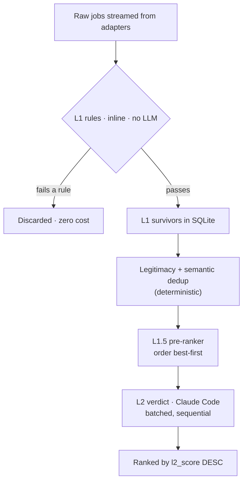

# Filtering & ranking

Lantern narrows a large pool of raw postings to a small ranked shortlist in two
tiers. The first is deterministic and free; the second uses the language model
and is reserved for what rules cannot decide.

## L1: deterministic rules

L1 ([`src/core/filter.ts`](../src/core/filter.ts)) runs on every job as it streams
in and typically discards around 80% of the pool at no cost. A job passes only if
it clears every rule. The rules follow a consistent philosophy: **do not drop what
you cannot evaluate.** Missing data passes and defers to L2.

- **Title.** The job title must contain at least one positive keyword and none of
  the negative keywords. Keywords come from the parsed search, expanded with
  synonyms and stack terms.
- **Location.** Precedence is `always_allow` > `block` > `allowed`. A blocked
  region fails even a remote role (this catches "Remote, US only" when the US is
  blocked). The `allowed` list constrains only non-remote roles, since a remote
  job is otherwise location-agnostic. An empty location always passes.
- **Salary floor.** Compared only when the job and the criteria currencies are
  both known and equal. Lantern does no currency conversion, so a mismatch or an
  unknown currency passes.
- **Seniority gate.** Engages **only** when the search restricts to junior/mid. It
  drops titles that advertise a senior-or-above level (senior, staff, principal,
  director, VP, and similar), while deliberately keeping level-ambiguous words
  like *lead*, *manager*, and *architect*. It is title-only, so a senior role with
  a plain title still reaches L2.
- **Freshness gate.** Optional, on by default at 7 days. A job with a posted date
  older than the window fails; a job with no posted date always passes. This trims
  stale postings before they reach the model.

The seniority and freshness gates exist mainly to shrink the L2 queue, which is
the binding cost. Both are conservative, and they only ever drop jobs that are
clearly out of scope.

## L2: the language-model verdict

L2 ([`runL2Pass` in `src/runner/scan.ts`](../src/runner/scan.ts)) grades the
survivors against the criteria. Each job gets a fit boolean, a 0–1 score,
detected seniority, stack matches, and short reasons. When a résumé is enabled, a
background-fit sub-score and gap list are added, without changing how the
criteria score is judged (see [intelligence.md](intelligence.md)).

Two properties keep L2 affordable and honest:

- **Batched, not per-job.** Each Claude Code invocation re-pays a large fixed
  cost (system prompt, JSON schema, CLI scaffolding) that cannot be cached across
  processes. Grading 20 jobs per call amortizes that overhead. Batches run
  sequentially. Every job is still graded independently on its own
  title/company/description.
- **Incremental and resumable.** L2 scores only survivors whose verdict is still
  NULL, scoped to the current run. If a run is interrupted (a provider limit, for
  example), the scored verdicts are kept and the next scan grades only the rest. It
  does not re-grade unless the criteria changed and invalidated the old verdicts.

L2 also guards against a wedged provider: a fatal error aborts immediately, and a
few consecutive transient failures stop the pass rather than blasting through
hundreds of jobs.

## Ranking

Results are scoped to the current search through `last_run_id` and ordered by
`l2_score` descending. The pre-ranker (L1.5) does not change this final order. It
changes the order L2 *scores* jobs in, so the best matches surface earliest while
the pass is still running. Deduplicated reposts and jobs that failed L1 are hidden
from the default view.
