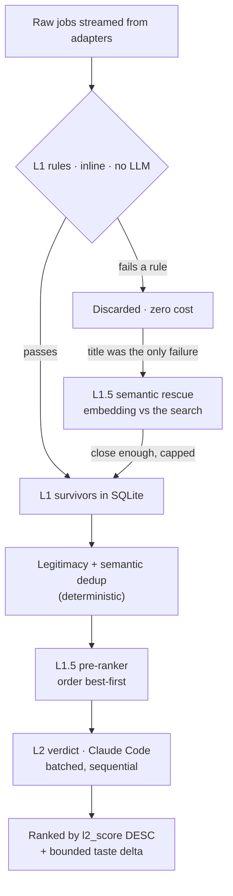

# Filtering & ranking

Lantern narrows a large pool of raw postings to a small ranked shortlist in two
tiers. The first is deterministic and free; the second uses the language model
and is reserved for what rules cannot decide.

## L1: deterministic rules

L1 ([`src/core/filter.ts`](../src/core/filter.ts)) runs on every job as it streams
in and typically discards around 80% of the pool at no cost. A job passes only if
it clears every rule. The rules follow a consistent philosophy: **do not drop what
you cannot evaluate.** Missing data passes and defers to L2.

**Whole-word terms.** Every criteria term (title keywords, location terms,
company excludes) matches as a whole word or phrase, case-insensitively and
ignoring accents, with `-`, `_` and `/` read as spaces (`termMatches` in
`filter.ts`). So `us` does not match "Austin" or "Brussels", `intern` does not
match "International", `java` does not match "JavaScript", and `meta` does not
match "Metabase". Meanwhile `full stack` matches "Full-Stack" and "Fullstack",
and `ci/cd` matches "CI-CD". A term that starts or ends with a symbol keeps
working (`c++`, `c#`, `.net` matches "ASP.NET"). Blank terms are dropped, so an
empty exclude can't exclude every company.

- **Title.** The job title must contain at least one positive keyword and none of
  the negative keywords. Keywords come from the parsed search, expanded with
  synonyms and stack terms. A job whose *only* failure is the missing positive
  keyword is stored with exactly that reason, which makes it a candidate for
  [semantic rescue](#semantic-rescue-l15) below.
- **Location.** See [Location and geography](#location-and-geography) below. An
  empty location always passes.
- **Salary floor.** Compared only when the job and the criteria currencies are
  both known and equal (case-insensitive). Lantern does no currency conversion,
  so a mismatch or an unknown currency passes. A range is compared by its top: a
  $140k–$190k posting clears a $150k floor, and only a range entirely below the
  floor fails. A min-only posting is compared by its minimum.

  Most boards (Greenhouse, Recruitee, Personio, BambooHR, Teamtailor, many
  aggregators, HN) have no structured salary but state it in the description, so
  before L1 the runner reads it from the JD text when the source supplied none
  (and again after `enrich()` brings in a late JD). A source's own salary is never
  overridden, and structured pay from an enrich call wins over text. The reader
  ([`salary.ts`](../src/core/salary.ts)) is deterministic and precision-first,
  because a wrong salary drops a good job while a missing one only defers to L2:

  - It needs an explicit currency (`$ € £ ₹`, an ISO code, `LPA`/lakh) next to a
    pay cue ("salary", "pay range", "base", "compensation", "OTE"), or a range
    with a stated period. Bare numbers, years and `401k` never qualify.
  - Handles `k`/`m` suffixes, `85.000` and `85,000` grouping, Indian `25,00,000`
    and `25 LPA`, en/em dashes and "to", and "up to" / "from" / `150k+`.
  - Periods are annualised: hour x2080, day x260, week x52, month x12. A figure
    with no stated period is read as annual only when it is a plausible annual
    amount for its currency; anything smaller is dropped.
  - Bonus, signing, equity, stipend, relocation, funding, revenue, deal-size and
    benefit amounts are rejected, as are implausible magnitudes.
  - A bare `$` is resolved from a single dollar currency named in the text
    (`USD`, `CAD`...) or a single dollar country in the job location. If neither
    pins it down the salary is dropped rather than stored with no currency.
  - Base-salary cues outrank generic pay words, which outrank OTE. OTE is accepted
    when it is all there is: an OTE below the floor means base is too, so the
    error can only keep a job. When equally ranked ranges differ (pay by region)
    the envelope is used, or nothing if it is more than 2.5x wide.

  The result is stored with `salary_source = 'jd'` and shown with "≈". Adapters
  with structured hourly or monthly pay (Ashby, Lever, Himalayas, Jobicy,
  Rippling, SmartRecruiters) annualise it by the same convention instead of
  dropping it.
- **Seniority gate.** Engages **only** when the search restricts to junior/mid. It
  drops titles that advertise a senior-or-above level (senior/sr/snr, principal,
  director, VP, head of, distinguished), plus *staff* when it precedes a tech noun
  ("Staff Software Engineer", but not "Staff Accountant"), and ladder rungs III and
  above on SDE, engineer, and developer titles ("SDE-3", "Software Engineer IV";
  "Engineer II" passes). It deliberately keeps level-ambiguous words like *lead*,
  *manager*, and *architect*, and programme titles like "Research Fellow". It is
  title-only, so a senior role with a plain title still reaches L2.
- **Freshness gate.** Optional, on by default at 7 days. A job with a posted date
  older than the window fails; a job with no posted date always passes. This trims
  stale postings before they reach the model.

- **Employment type.** Engages only when the search names types (contract,
  internship, part-time, full-time, temporary). A job is dropped only when its
  title, or an ATS's structured commitment field (Lever, Ashby), states a type and
  none of the stated types is wanted. "Engineer (Contract / Full-time)" states two,
  so either wish saves it. Matching is whole-word ("International" and "Internal"
  are not interns), and "Contract Manager" or "Contract Specialist" name a function,
  not an engagement. A title that says nothing passes.
- **Visa sponsorship.** Engages only when the search says the user needs
  sponsorship. It drops a job whose description explicitly refuses it ("unable to
  sponsor", "does not offer visa sponsorship", "no visa sponsorship", "authorized to
  work in the US without sponsorship", "candidates who require sponsorship will not
  be considered"). A description that also says sponsorship is available ("we
  cannot sponsor contractors but can sponsor employees"), or says nothing, passes
  and L2 decides ([`visa-sponsorship.ts`](../src/core/visa-sponsorship.ts)). A
  refusal counts only when its sentence is about immigration (visa, work permit,
  H-1B, right to work) or "sponsor" ends the clause, so "unable to sponsor
  conference attendance" does not drop a job.
- **Industry excludes.** `industries.exclude` terms match as whole words against the
  company name and the title only, never the description, since a posting
  mentioning "crypto" or "defense" in passing says nothing about the employer. The
  rest of the exclusion (a company that is crypto without saying so) is L2's.
  Words that are also job functions (finance, security, health, payments, data,
  insurance, marketing, sales, ...) are matched against the company name only, so
  "Insurance Data Engineer" survives a "no insurance" search.

Skills, `industries.include` and company stage never gate L1. They are L2-only.

The seniority and freshness gates exist mainly to shrink the L2 queue, which is
the binding cost. Both are conservative, and they only ever drop jobs that are
clearly out of scope.

### Location and geography

Location terms resolve through a deterministic gazetteer
([`src/core/geo.ts`](../src/core/geo.ts)). It holds countries with their names,
aliases, and codes, major cities and tech hubs, states and provinces for India,
the US, Canada, Australia, and Germany, and region groups (APAC, South Asia,
EMEA, Europe/EU, LATAM, North America, Americas, Middle East/MENA, Africa,
Oceania/ANZ, and a few more) mapped to their member countries. Lookups are table
lookups with no model tokens. So `allowed: ["india"]` passes "Bangalore",
"Gurugram", and "Mumbai Metropolitan Region", and "Indianapolis, IN" resolves to
the US, not India. Ambiguous names produce no signal on their own: "Georgia",
"Jersey", "Cambridge", and bare lowercase codes like "in", "ca", or "de". US and
Canadian state codes count only in a "City, ST" position, and only when the city
doesn't belong to another country ("Chennai, TN" is Tamil Nadu). Uppercase country
codes ("Remote - US") count, but lowercase ones in prose do not. A criteria term
that is exactly a code ("us", "uk") resolves either way.

The tiers apply in precedence order `always_allow` > `block` > `allowed`:

- **always_allow** is the user's **home region(s)**. A location that matches one,
  as a whole word or through any overlap with the gazetteer (a job that says
  "APAC" overlaps "india"), always passes, even when it also names a blocked
  region.
- **block** fails a location that matches a term as a whole word, or whose place
  lies *inside* the blocked place ("Austin, TX" is inside "united states"). A
  region only partly inside it ("Americas") is not dropped on a guess. Block
  applies to remote roles too, which catches "Remote (US only)".
- **allowed**, for on-site and hybrid jobs, passes a location that matches a term
  as a whole word or overlaps it geographically (a job "Germany" overlaps allowed
  "europe"). Otherwise the job fails.
- **Remote eligibility.** When `allowed` ∪ `always_allow` names at least one
  recognized place, a remote job (remote flag or remote wording) fails if its
  location names recognized places, none of which overlaps those places, and it
  carries no worldwide marker (anywhere, worldwide, global, all locations). The
  reason reads like `remote but restricted to United States`. So on an India
  search "Remote - US", "Canada - Remote (ON, AB, BC…)", and "Remote (EMEA)" fail.
  Meanwhile plain "Remote", "Anywhere", "Remote - India", "APAC", a multi-country
  list that includes India, an unrecognized place, and an empty location all pass.
  Without any recognized home or allowed place, remote jobs stay
  location-agnostic.
- `remote_required` is unchanged: it fails only jobs that say on-site or hybrid
  without also saying remote.

### L1 on cached boards

The background refresher (see [architecture.md](architecture.md#background-board-refresher))
writes stored jobs without running L1, and a real edit it detects clears that job's L2
verdict and embedding between searches, so `l2_pending` can rise until the next search
re-grades it.

A board fetched within the board-cache TTL is not fetched again: L1 re-runs over its
stored jobs (see [architecture.md](architecture.md#board-cache)). Every field
`l1Filter` reads is therefore a persisted `jobs` column (`title`, `company`,
`location`, `remote`, `salary_*` with `salary_currency`, `posted_at`,
`employment_type`, `jd_text`), and a new L1 input must get a column first. Cached
and live L1 agree for unchanged postings (a property test runs every rule against
both). `posted_at` keeps the EARLIER of the stored and fetched dates on both paths
(`upsertJob` adopts an earlier fetched date, only from the source that owns the row), so a relative date re-derived each fetch
(Workday) can't make a job look newer. The one documented drift is a `jd_text` edited
without a title or location change, because `upsertJob` keeps the first-seen JD.
`employment_type` is not in `content_hash`: it follows each sighting but never clears a
verdict. A posting a board shares with another source's row (same URL, or folded into it) is
evaluated from that row's stored data, where a live fetch grades the board's own copy.

## Semantic rescue (L1.5)

The title rule is blunt: "Software Engineer II" on a "backend engineer" search is
dropped even when its description is all backend work. After the scan and before
L2, [`applySemanticRescue`](../src/runner/semantic-rescue.ts) re-admits some of
those jobs, using the local embedding model (see
[intelligence.md](intelligence.md)). It is deterministic and costs no LLM tokens.

- **Candidates** are this run's jobs whose only L1 failure was the missing title
  keyword (location, salary, seniority, freshness, excludes and negative title all
  passed) and that carry a description of at least 200 characters. A title-only
  rescue is too noisy. Jobs from adapters that fetch the description only in
  `enrich()` (LinkedIn, Workday, SmartRecruiters and similar) have none at this
  point and are not considered, because enrichment runs for L1 survivors only.
- **Promotion** compares the job (title, company, description) with an anchor by
  cosine similarity. The anchor is the **centroid of this run's L1 survivors**
  (real examples of what matched the search), needing at least 5 of them; with
  fewer it falls back to the query anchor the pre-ranker uses. The cut is 0.41
  against the centroid and 0.40 against the query anchor. At most 3 survivors per
  company feed the centroid, and a centroid-promoted job must also be at least
  0.24 similar to the query: both guard against one company's shared boilerplate
  pulling the centroid onto its own unrelated postings. At most 40 jobs are
  promoted per run, best first. A promoted job gets `l1_pass = 1` and
  `l1_rescued = 1`, and the Jobs list shows a quiet "semantic match" note.
- **Why a loose cut is fine.** A rescued job is not presented as a match. It joins
  the L2 queue and L2 is the judge, while the cap of 40 bounds the cost to two L2
  batches. A false promotion therefore costs a few tokens, but a missed one is a
  job the user never sees, so the threshold targets recall at a precision of about
  0.6 rather than near-perfect precision.
- **Recomputed each scan.** Every scan rewrites `l1_pass` and clears `l1_rescued`
  for the jobs it surfaces, so a changed search never inherits a stale rescue.
- **Cost bound.** Candidates that already carry an embedding are scored for free.
  At most 2000 still needing one are embedded per run, newest posted first
  (`posted_at`, else first seen). Once embedded they stop using that budget, so older
  candidates are reached on later runs. `rescue_start` announces the pass.
- **Stale rescues.** The Jobs API's fit view also requires `l1_pass = 1`, so a job
  rescued in one run and not in the next does not keep showing as a fit.
- **Optional.** With Semantic ranking off, or if the model cannot load, rescue is a
  no-op and the scan is unchanged.
- **Calibration.** `bun run scripts/calibrate-rescue.ts` scores a labelled set of
  116 generic-title postings over 8 searches (engineering and not), with thresholds
  chosen on half the searches and reported on the other half. On the held-out half
  the centroid anchor (with the query floor) reaches recall 0.88 at precision 0.66
  (AUC 0.84), against
  AUC 0.78 and recall 0.25 for the query anchor alone, which is why the centroid is
  preferred. The fixture's match rate is far above a real pool's, so real precision
  will be lower; the cap is what keeps that affordable.

Some full-feed sources (Working Nomads, We Work Remotely, The Muse, HN "Who is
hiring?") admit a posting when a keyword appears in its title **or** description,
and JobTech applies no title filter on top of its own search, so generic-title
postings reach L1 and rescue at all.

## L2: the language-model verdict

L2 ([`runL2Pass` in `src/runner/scan.ts`](../src/runner/scan.ts)) grades the
survivors against the criteria. Each job gets a fit boolean, a 0–1 score,
detected seniority, stack matches, and short reasons. When a résumé is enabled, a
background-fit sub-score and gap list are added, without changing how the
criteria score is judged (see [intelligence.md](intelligence.md)).

Two properties keep L2 affordable and honest:

- **Batched, not per-job.** Each Claude Code invocation re-pays a large fixed
  cost (system prompt, JSON schema, CLI scaffolding) that cannot be cached across
  processes. Grading 20 jobs per call amortizes that overhead. Batches run
  sequentially. Every job is still graded independently on its own
  title/company/description.
- **Incremental and resumable.** L2 scores only survivors whose verdict is still
  NULL, scoped to the current run. If a run is interrupted (a provider limit, for
  example), the scored verdicts are kept and the next scan grades only the rest. It
  does not re-grade unless the criteria changed and invalidated the old verdicts.

The rubric also reads the parsed intent fields, without adding any verdict output
field: a clearly missing `skills.must` entry, an excluded or non-included industry,
a company stage mismatch, or a description that refuses sponsorship when the user
needs it all make `fit` false, while `skills.nice` only raise the score. A
description too thin to confirm a must-have skill is capped at 0.6 like the
location and experience cases. The explanation travels in `reasons`.

L2 also guards against a wedged provider: a fatal error aborts immediately, and a
few consecutive transient failures stop the pass rather than blasting through
hundreds of jobs.

## Ranking

Results are scoped to the current search through `last_run_id`. Within a view the
order is: L2-scored jobs first, fits before non-fits, then `l2_score` descending,
then L1 survivors, then recency. The pre-ranker (L1.5) does not change this final
order. It changes the order L2 *scores* jobs in, so the best matches surface
earliest while the pass is still running. Deduplicated reposts and jobs that failed
L1 are hidden from the default view.

**Taste blend.** Once you have shortlisted at least three jobs, `l2_score` is
blended with a small learned-taste delta of at most +/-0.1 (see
[intelligence.md](intelligence.md#6-learned-taste)). It reorders near-ties only: a
gap of more than 0.2 is never reversed, and the fit tier means a non-fit cannot pass a
fit. It never touches L1 or L2 pass/fail. Hidden jobs stay in the list, dimmed.
