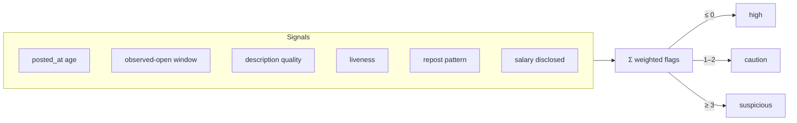

# Ghost-job detection

A meaningful share of job listings are never really open: reposted endlessly,
left up long after they filled, or posted to collect résumés. Lantern rates every
posting for legitimacy so you can spend attention where it is likely to pay off.
This is the feature nothing comparable does well, and it is deliberately honest
about its limits.

## What the badge means

Each job gets one of three ratings, shown with the reasons behind it:

| Badge | Meaning |
|---|---|
| **high** | No red flags found. *Not* a claim that the job is verified real. |
| **caution** | One or two weak signals worth noticing. |
| **suspicious** | Enough signals stacked up to warrant skepticism. |

The framing is the point. A `high` badge says only that Lantern found nothing
against the posting, not that it confirmed anything. Unknown inputs (a missing
posted date, an unchecked apply page) count in neither direction.

## The scorer

The scorer ([`src/core/legitimacy.ts`](../src/core/legitimacy.ts)) is pure and
deterministic: no language model, no clock access, no database. It adds up
weighted signals and maps the total to a rating.

### Signals and weights

| Signal | Weight | Why |
|---|:---:|---|
| Posted ≥ 90 days ago, still listed | +2 | Long-open roles are disproportionately stale or evergreen. |
| Posted ≥ 45 days ago | +1 | A softer version of the same. |
| Observed open ≥ 45 days across scans | +1 | Independent of the board's posted date, which can be reset. |
| Description very thin or absent | +1 | Vague postings correlate with low-intent listings. |
| Apply page appears closed | +3 | The strongest negative; the role is gone. |
| Apply page verified reachable | −1 | A genuine positive. |
| Re-listed on the same board | +2 | Repost churn on one board. |
| Listed across ≥ 4 boards | +1 | Wide blasting; weaker, since some syndication is normal. |
| Salary disclosed | −1 | The strongest anti-ghost predictor; offsets one weak flag. |

A rating of `high` therefore emerges either from no signals at all or from a weak
flag offset by a positive (for example, posted 50 days ago but with salary
disclosed). Because the reasons carry a sign, the UI renders an offsetting
positive as a `+`, not as another strike.

## How the signals are derived

Everything comes from data Lantern already has, with no extra fetch:

- **Age and observed-open window** come from `posted_at`, `first_seen`, and
  `last_seen`. The posted date is never overwritten on re-scan, so it stays the
  original.
- **Repost patterns** come from `duplicate_urls`. Fuzzy dedup merges a repost into
  the canonical row, so same-host entries mean churn on one board and many
  distinct hosts mean cross-board blasting.
- **Description quality** reads `jd_text`. A NULL description means the *adapter*
  cannot fetch one, which is Lantern's gap, not the posting's, so it counts for
  nothing. Only a present-but-thin description is a signal.
- **Liveness** is filled in later, when a shortlisted job's apply page is checked
  (see [browser-tier.md](browser-tier.md)).

## When it runs

The legitimacy pass ([`src/runner/legitimacy.ts`](../src/runner/legitimacy.ts))
runs over a run's survivors after the scan and before grading, so badges are ready
while L2 is still scoring. A single job is re-scored after each liveness check,
since reachability is one of its strongest inputs.

## Reading it honestly

The scorer is a heuristic, and the thresholds are conservative by design. It will
not catch every ghost, and a `suspicious` badge is a prompt to look closer, not a
verdict. Treat it as one input among several, alongside the fit score, the salary
signal, and your own read of the description.
