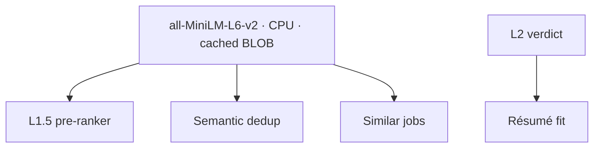

# Semantic intelligence

Lantern runs a small sentence-embedding model on your machine and uses it to make
the shortlist smarter. There is no GPU requirement and no external API. The model
is CPU-only and the vectors never leave the machine.

## The embedding layer

The model is `all-MiniLM-L6-v2`, quantized to 8-bit and run through the ONNX CPU
backend ([`src/core/embed.ts`](../src/core/embed.ts)). The first time the feature
is used it downloads about 25 MB of weights once and caches them under `models/`
(gitignored). Each job is embedded from its title, company, and description into a
384-dimension vector, stored once as a BLOB in the `jobs.embedding` column and
reused thereafter.

Semantic ranking is **on by default** and can be turned off in Settings, which
skips the download and the model load entirely. The vector is computed lazily,
only for jobs that reach the stage that needs it.

Four features share this one substrate:

## 1. The L1.5 pre-ranker

Before L2 grades the survivors, the pre-ranker
([`src/runner/preranker.ts`](../src/runner/preranker.ts)) orders them by cosine
similarity to the search. Because L2 runs sequentially, this means the best
matches are scored first and stream to the UI earliest.

It is **reorder-only**. It never drops a job and never changes the final
`l2_score` ordering, only the order in which jobs are graded. If the feature is
off or anything fails, the original order stands.

## 2. Semantic dedup

Lexical dedup already merges reposts whose titles share tokens. Semantic dedup
([`src/runner/semantic-dedup.ts`](../src/runner/semantic-dedup.ts)) catches the
case it misses: the **same employer** reposting a role under a reworded title
whose descriptions embed nearly identically.

Precision is the whole game: a wrong merge hides a real distinct opening, so the
pass is conservative:

- It only ever compares jobs with the **same normalized company**, which makes it
  structurally impossible to collapse two different employers.
- It requires a high cosine similarity (0.95).
- It **marks rather than deletes**. The duplicate keeps its row and points to the
  canonical job through `duplicate_of`; the canonical absorbs the duplicate's URL.

Folded duplicates are hidden from the default list and skipped by L2 (a cost
saving), and the UI surfaces the fold with a "reposts" count and a section noting
those postings were not separately scored.

## 3. Similar jobs

The detail panel shows the nearest neighbors of the selected job by cosine
similarity, spanning all embedded jobs. It is read-only, and each result opens the
posting in a new tab. Deduplicated jobs are excluded so the view does not
re-surface what dedup hid.

## 4. Résumé fit

Résumé fit is opt-in and, unlike the three above, is driven by L2 rather than the
embedding layer. When you save a master résumé and enable it, every verdict gains
a `background_fit` sub-score and a short list of gaps, judged against your
background. It sits **alongside** the criteria score rather than replacing it.

Two stages keep this coherent with per-job tailoring:

- **Triage scoring** (this feature) runs *before* you decide, against your
  baseline résumé.
- **Tailoring** (a later, apply-stage feature) runs *after* you pick a job.

The résumé lives in the settings store as text (paste it, or import from a PDF and
edit the extraction). The PDF is transient and never persisted. Changing the
résumé while it is enabled invalidates cached verdicts, exactly as changing the
search does, because the meaning of the score changed.
