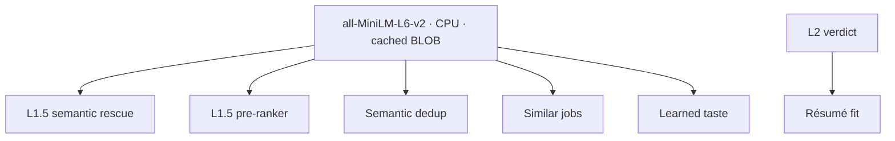

# Semantic intelligence

Lantern runs a small sentence-embedding model on your machine and uses it to make
the shortlist smarter. There is no GPU requirement and no external API. The model
is CPU-only and the vectors never leave the machine.

## The embedding layer

The model is `all-MiniLM-L6-v2`, quantized to 8-bit and run through the ONNX CPU
backend ([`src/core/embed.ts`](../src/core/embed.ts)). The first time the feature
is used it downloads about 25 MB of weights once and caches them under `models/`
(gitignored). Each job is embedded from its title, company, and description into a
384-dimension vector, stored once as a BLOB in the `jobs.embedding` column and
reused thereafter.

Semantic ranking is **on by default** and can be turned off in Settings, which
skips the download and the model load entirely. The vector is computed lazily,
only for jobs that reach the stage that needs it.

Six features share this one substrate:

## 1. Semantic rescue

L1 requires a search keyword in the job title, so a generic title such as
"Software Engineer II" is dropped even when the description is exactly what you
searched for. Semantic rescue ([`src/runner/semantic-rescue.ts`](../src/runner/semantic-rescue.ts))
runs between the scan and L2 and re-admits the jobs whose *only* L1 failure was
that missing title keyword, when their text embeds close to the search.

Unlike the pre-ranker it **adds** to the L2 queue, so it is bounded: a
description of at least 200 characters and at most 40 promotions per run, best
first. A job is compared with the centroid of the run's own L1 survivors (the
query anchor when fewer than 5 survivors exist). Because L2 is the real judge and
the cap bounds its cost, the threshold favours recall over precision. Promoted
jobs carry `l1_rescued = 1` and show a "semantic match" note in the Jobs list. The
threshold was calibrated with `scripts/calibrate-rescue.ts`. Details are in
[filtering-and-ranking.md](filtering-and-ranking.md#semantic-rescue-l15).

Turning Semantic ranking off disables rescue too, and any failure leaves the L1
verdicts untouched.

## 2. The L1.5 pre-ranker

Before L2 grades the survivors, the pre-ranker
([`src/runner/preranker.ts`](../src/runner/preranker.ts)) orders them by cosine
similarity to the search. Because L2 runs sequentially, this means the best
matches are scored first and stream to the UI earliest.

It is **reorder-only**. It never drops a job and never changes the final
`l2_score` ordering, only the order in which jobs are graded. If the feature is
off or anything fails, the original order stands. Once [learned taste](#6-learned-taste)
is active, its small bounded delta is added to each job's similarity, so
shortlist-like jobs are graded a little earlier.

## 3. Semantic dedup

Lexical dedup already merges reposts whose titles share tokens. Semantic dedup
([`src/runner/semantic-dedup.ts`](../src/runner/semantic-dedup.ts)) catches the
case it misses: the **same employer** reposting a role under a reworded title
whose descriptions embed nearly identically.

Precision is the whole game: a wrong merge hides a real distinct opening, so the
pass is conservative:

- It only ever compares jobs with the **same normalized company**, which makes it
  structurally impossible to collapse two different employers.
- It requires a high cosine similarity (0.95).
- It **marks rather than deletes**. The duplicate keeps its row and points to the
  canonical job through `duplicate_of`; the canonical absorbs the duplicate's URL.

Folded duplicates are hidden from the default list and skipped by L2 (a cost
saving), and the UI surfaces the fold with a "reposts" count and a section noting
those postings were not separately scored.

## 4. Similar jobs

The detail panel shows the nearest neighbors of the selected job by cosine
similarity, spanning all embedded jobs. It is read-only, and each result opens the
posting in a new tab. Deduplicated jobs are excluded so the view does not
re-surface what dedup hid.

## 5. Résumé fit

Résumé fit is opt-in and, unlike the four above, is driven by L2 rather than the
embedding layer. When you save a master résumé and enable it, every verdict gains
a `background_fit` sub-score and a short list of gaps, judged against your
background. It sits **alongside** the criteria score rather than replacing it.

Two stages keep this coherent with per-job tailoring:

- **Triage scoring** (this feature) runs *before* you decide, against your
  baseline résumé.
- **Tailoring** (a later, apply-stage feature) runs *after* you pick a job.

The résumé lives in the settings store as text (paste it, or import from a PDF and
edit the extraction). The PDF is transient and never persisted. Changing the
résumé while it is enabled invalidates cached verdicts, exactly as changing the
search does, because the meaning of the score changed.

## 6. Learned taste

Lantern learns from how you triage and uses it to **order** results. It never
decides which jobs pass L1 or L2 and adds no LLM tokens
([`src/core/preference.ts`](../src/core/preference.ts),
[`src/runner/preference.ts`](../src/runner/preference.ts)).

**Signals.** Liked: status `shortlist`, `applied`, `interview`, `offer`, or any job
you ever applied to (`applied_at` is stamped once and never cleared, so an employer's
later `rejected` still counts as a like). Disliked: `hidden` or `rejected` without
ever applying. "Not interested" in the detail panel sets `hidden`; there is no new
status. A hidden job stays in the list, dimmed, and "Restore" puts it back to `new`.

**Model.** From the cached vectors of those jobs it builds a liked centroid and a
disliked centroid (unit-length means). At most 2 jobs per company count per side, so
one employer's boilerplate cannot drag a centroid and the 3-job minimum implies at
least two companies. The 200 most recently discovered (highest id, since triage has no timestamp) per side win. It activates only with at least 3
liked jobs; the disliked centroid needs its own 3, else it is ignored. A job's raw
preference is `sim(liked) - 0.5 * sim(disliked)`.

**Where it applies.**

- The Jobs list order. `ORDER BY` becomes: L2-scored first, fits before non-fits, then
  `l2_score + delta`, then L1 survivors, then recency. The delta is
  `0.5 * (raw - median raw of the jobs in the view)`, clamped to +/-0.1. So it
  reorders near-ties, cannot reverse a gap of more than 0.2, and cannot lift a non-fit
  over a fit (the fit tier). Each job carries `pref_adjust`, and a not-yet-triaged
  job at +0.06 or more shows a quiet "like your shortlist" note. With no model the
  plain SQL order runs and `pref_adjust` is `null`.
- The L1.5 pre-ranker, as above.

It is computed per request instead of stored: a person triages tens to hundreds of
jobs, so rebuilding two centroids is cheaper than invalidating a stored one on every
status change, and nothing here can go stale. List ranking reads vectors only for
L2-scored rows. It never embeds, so it cannot load the model. Turning Semantic
ranking off disables it, and a job whose content changed loses its vector (and drops
out of the model) until it is next embedded.

`PREF_LAMBDA`, `PREF_GAIN` and the minimums are untuned: there is no triage data to
calibrate on yet, unlike rescue. They are exported constants in `core/preference.ts`.

**Calibration.** `GET /api/jobs/calibration` (shown under Settings, "Learned taste")
reports, for shortlisted/applied versus hidden jobs, how many carry a current verdict,
their mean `l2_score`, how many shortlisted jobs L2 called non-fits, and how many
hidden jobs it called fits. A criteria change clears verdicts, so jobs triaged under
older searches count as triaged but not scored.

**Not built: a taste block in the L2 prompt.** Listing liked/dismissed titles to L2
would cost roughly 150-250 tokens per batch call (about 1% of a 20-job batch) but
would let a handful of clicks shift `fit`/`score` themselves, which the resume block
deliberately avoids to keep scores comparable across runs. Personalization stays in
the ordering, where it is bounded.
