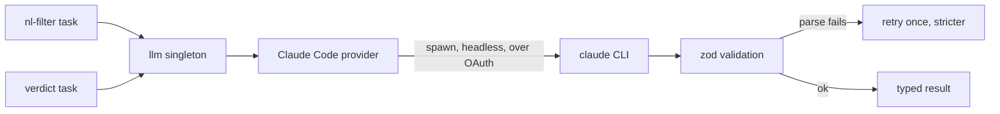

# LLM provider

Lantern uses a language model for exactly two jobs: turning a search sentence into
structured criteria, and grading job survivors. Both go through a single provider,
your own Claude Code session, reached through one interface.

## One provider, one interface

The only generative provider is **Claude Code**. There is no provider switcher, no
API key, and no base URL. Everything routes through the `llm` singleton
([`src/llm/index.ts`](../src/llm/index.ts)); nothing else in the codebase calls the
model directly.

## The two tasks

- **`nl-filter`** turns the user's sentence into the structured criteria: title
  terms and synonyms, location tiers, salary floor with currency, seniority
  levels, and exclusions. The prompt is in
  [`src/llm/prompts.ts`](../src/llm/prompts.ts).
- **`verdict`** grades a batch of jobs against the criteria, returning fit, a 0–1
  score, seniority, stack matches, and reasons, plus background fit and gaps when
  a résumé is enabled.

## How the CLI is invoked

The provider ([`src/llm/providers/claude-code.ts`](../src/llm/providers/claude-code.ts))
spawns the `claude` CLI in headless mode and isolates it from your personal
environment so a scan behaves the same for everyone:

- `-p --output-format json --json-schema` gives headless, structured output validated
  against a schema.
- `--system-prompt` sets a minimal focused prompt, replacing the agentic default.
- `--setting-sources ''`, `--strict-mcp-config --mcp-config '{}'`,
  `--disable-slash-commands`, and a throwaway working directory, so no user settings,
  hooks, MCP servers, skills, or project auto-discovery leak in.
- The prompt is piped on stdin to avoid multi-line argument truncation.

The CLI must be on your `PATH` and signed in; it runs over your existing OAuth
login, so there is no separate key step.

> One gotcha worth preserving: `claude --bare` reads only an API-key environment
> variable and breaks subscription OAuth. The provider does **not** use it; it
> isolates context with the flags above instead.

## Schema validation

Every model response is parsed through a zod schema in
[`src/llm/schemas.ts`](../src/llm/schemas.ts). The provider's `call()` honors a
strict contract: on a parse failure it retries once with a "JSON only, no prose"
addendum; on a second failure it logs and skips. A malformed response never
reaches the rest of the system as if it were valid.

## Model overrides

Which model handles each task is configurable from the Settings page and stored in
the settings table (`llm` row), re-read on every call. Grading defaults to a
mid-tier model; the two tasks can be pointed at different models independently.

## Cost shape

Each CLI invocation re-pays a fixed, uncacheable cost (the system prompt, the
schema, and CLI scaffolding, re-sent every subprocess). That is why grading is
batched (20 jobs per call) and why the deterministic L1 gates exist: to keep the
number of jobs that reach the model small. See
[filtering-and-ranking.md](filtering-and-ranking.md).
