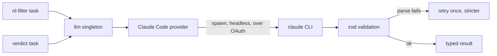

# LLM provider

Lantern uses a language model for exactly two jobs: turning a search sentence into
structured criteria, and grading job survivors. Both go through a single provider,
your own Claude Code session, reached through one interface.

## One provider, one interface

The only generative provider is **Claude Code**. There is no provider switcher, no
API key, and no base URL. Everything routes through the `llm` singleton
([`src/llm/index.ts`](../src/llm/index.ts)); nothing else in the codebase calls the
model directly.

## The two tasks

- **`nl-filter`** turns the user's sentence into the structured criteria: title
  terms and synonyms, location tiers (countries/regions, not cities — L1 expands
  each one to its cities via a gazetteer), an experience-years range, salary
  floor with currency, seniority levels, and exclusions. The prompt is in
  [`src/llm/prompts.ts`](../src/llm/prompts.ts).
- **`verdict`** grades a batch of jobs against the criteria, returning fit, a 0–1
  score, seniority, stack matches, and reasons, plus background fit and gaps when
  a résumé is enabled. Each job renders as one JSON-per-line record (never a
  free-text delimited block — a scraped title/description containing something
  shaped like a fake record can't forge one) and the prompt carries a grading
  rubric: an experience ceiling (1 year of tolerance), a remote-role's-region
  check against the user's allowed/home region(s), a confidence cap when
  location/experience can't be verified, and a reminder that the returned salary
  is an annual USD figure (converted from the JD's stated currency, not a raw
  passthrough). When the criteria's fixed schema can't capture something the
  user asked for (an excluded industry, a specific stack), the run's original
  search sentence is passed through too — the model treats it as authoritative
  for anything the criteria didn't capture, unlike the job fields, which are
  always untrusted data.

## How the CLI is invoked

The provider ([`src/llm/providers/claude-code.ts`](../src/llm/providers/claude-code.ts))
spawns the `claude` CLI in headless mode and isolates it from your personal
environment so a scan behaves the same for everyone:

- `-p --output-format json --json-schema` gives headless, structured output validated
  against a schema.
- `--system-prompt` sets a minimal focused prompt, replacing the agentic default.
- `--setting-sources ''`, `--strict-mcp-config --mcp-config '{}'`,
  `--disable-slash-commands`, and a throwaway working directory, so no user settings,
  hooks, MCP servers, skills, or project auto-discovery leak in.
- The prompt is piped on stdin to avoid multi-line argument truncation.

The CLI must be on your `PATH` and signed in; it runs over your existing OAuth
login, so there is no separate key step.

> One gotcha worth preserving: `claude --bare` reads only an API-key environment
> variable and breaks subscription OAuth. The provider does **not** use it; it
> isolates context with the flags above instead.

A bare command like `claude` is resolved against `PATH` at spawn time (`env:
process.env` is passed explicitly) rather than a PATH snapshot frozen at Bun's
own startup — otherwise a long-running `bun --watch` server wouldn't notice a
freshly-installed CLI without a restart.

## Retry contract

`call()` retries with a stricter "JSON only" suffix **only** when the CLI
process actually ran and either produced unparseable output or failed the
schema — never on a timeout, a non-zero exit (auth failure, usage limit,
missing CLI), or any other process-level failure, since those fail the exact
same way a second time. A timeout is reported as `LlmError('transient', 'timed
out after Ns')` rather than the raw "claude cli exit 143: (no output)" the CLI
leaves behind when it's killed.

Failure classification (`classifyErrorMessage` in
[`src/llm/provider.ts`](../src/llm/provider.ts)) matches status codes only in
context (`"API Error: 401"`, `"status 403"`) — a bare `401`/`403` anywhere in
the message (a request id, an unrelated number) is not enough, since transient
5xx/overload errors routinely carry those digits as substrings.

## Schema validation

Every model response is parsed through a zod schema in
[`src/llm/schemas.ts`](../src/llm/schemas.ts). The provider's `call()` honors a
strict contract: on a parse failure it retries once with a "JSON only, no prose"
addendum; on a second failure it logs and skips. A malformed response never
reaches the rest of the system as if it were valid. Verdict parsing is
deliberately more forgiving than the schema handed to the CLI: an off-enum
seniority falls back to `"unknown"` and a non-integer salary is rounded, rather
than failing an entire 20-job batch over one job's imperfect output — the
`--json-schema` sent to the CLI is unaffected (still the full enum / still
`integer`), only parsing the response back is lenient.

## Model overrides

Which model handles each task is configurable from the Settings page and stored in
the settings table (`llm` row), re-read on every call. Grading defaults to a
mid-tier model; the two tasks can be pointed at different models independently.
An override is spliced into the CLI's argv right after `--model`, so it's
validated against `MODEL_OVERRIDE_RE` (a strict model-id shape) both where it's
written (the settings route, 400 on a bad value) and where it's read back out
(the `llm` singleton, which ignores and logs a value that doesn't match rather
than ever handing something like `--dangerously-skip-permissions` to the CLI).

## Health checks

`GET /api/health` is cheap by default: CLI presence + `claude --version` only,
no model call — safe to hit on every Settings mount (twice under React
StrictMode) or mid-scan poll. `?deep=1` additionally runs a trivial structured
call to prove auth actually works, not just that the binary exists.

## Cost shape

Each CLI invocation re-pays a fixed, uncacheable cost (the system prompt, the
schema, and CLI scaffolding, re-sent every subprocess). That is why grading is
batched (20 jobs per call) and why the deterministic L1 gates exist: to keep the
number of jobs that reach the model small. See
[filtering-and-ranking.md](filtering-and-ranking.md).
