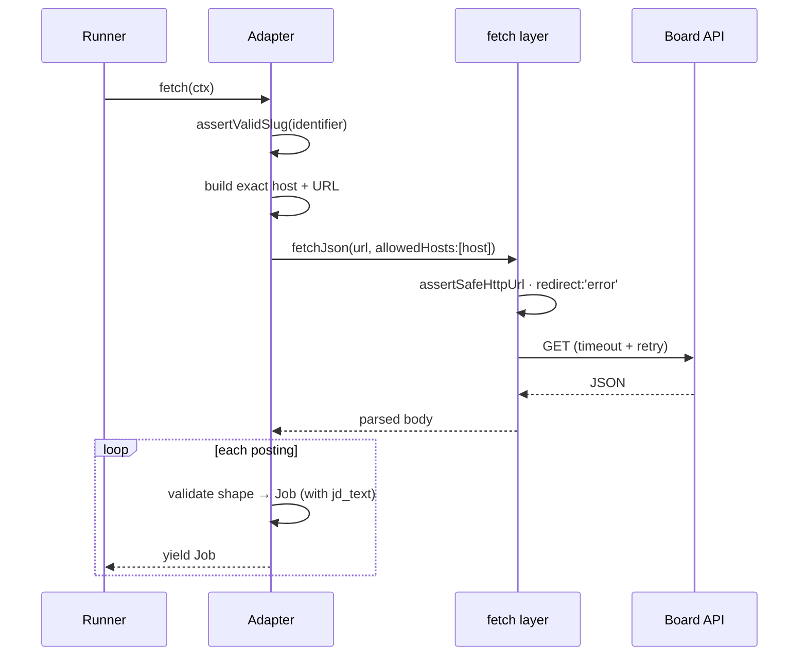

# Sources

A source is one place Lantern fetches jobs from. Every source is a public HTTP
API or feed, so there is no general web scraping in the default path. Adapters live
in [`src/sources/`](../src/sources) and are registered in
[`src/sources/index.ts`](../src/sources/index.ts).

## Two kinds of source

Sources come in two shapes, and the difference drives how a search reaches them.

| | Per-company board | Keyword aggregator |
|---|---|---|
| Needs a slug | Yes (the company's tenant) | No |
| Uses the search keyword | No, returns the whole board | Yes, the keyword drives the query |
| Example | `greenhouse:airbnb` | `remoteok` |
| Yields when keywords are empty | Still yields | Yields nothing |

Per-company boards return every open role for one employer; the criteria filter
narrows them afterward. Aggregators are keyword-global: they read the role terms
from the search and query the provider directly, so they contribute nothing to a
search with no title keywords.

## The adapter contract

An adapter is an async iterable so the runner can stream jobs into SQLite without
buffering:

```ts
interface SourceAdapter {
  fetch(ctx: SourceContext): AsyncIterable<Job>;
  enrich?(job: Job, ctx: SourceContext): Promise<Partial<Job> | null>;
}
```

`SourceContext` carries what the adapter needs from the current search: the source
config, the criteria-derived `keywords` and `locations`, whether remote is
required, `maxAgeDays` (the freshness window in days when the freshness gate is on,
otherwise undefined — for APIs with a recency filter, such as LinkedIn's `f_TPR`),
a progress callback, and an abort signal. The runner normalizes `keywords` before
handing them over: trimmed, lowercased, deduplicated, and with any keyword that
contains another as whole words dropped ("flutter developer" next to "flutter").

What the runner does around an adapter:

- **Per-source deadline.** Each source gets its own abort signal and an 8-minute
  deadline covering fetch and enrichment. On timeout the signal fires, the source
  is marked `last_status = 'timeout'`, and the scan moves on. Long paginated
  fetches should check `ctx.abortSignal` between pages.
- **Contract validation.** Every yielded job is checked against `JobShape`
  (`src/core/job.ts`). A job that fails (for example an empty URL or title) is
  skipped and counted in the source's `source_done` message, never stored.
- **Enrichment.** `enrich` is optional, for detail that costs one request per job
  (LinkedIn's JD). The runner calls it only for jobs that passed L1 and have no
  `jd_text` (and no JD already stored for that URL), sequentially, up to 40 calls
  per source per run, and merges the returned patch before storing. It should
  return null rather than throw on its own fetch failures; a throw is logged and
  treated as null. Per-run state such as a circuit breaker must be reset at the
  top of `fetch()`, since adapters are long-lived singletons.

Four rules are load-bearing (the full list is in
[`.claude/rules/source-adapters.md`](../.claude/rules/source-adapters.md)):

1. **Keep the SSRF guard.** Validate the slug, build the exact host, and pass it
   as an allowlist. Never fetch a user-supplied URL unguarded.
2. **Stream, don't buffer.** Yield `Job` objects; do not return an array.
3. **Populate `jd_text`.** The grader reads the description. If an adapter cannot
   fetch one, it leaves `jd_text` absent (NULL) rather than empty. An empty
   string reads as "no description" to the ghost scorer.
4. **Validate every parsed shape** against the contract, and keep the parse
   function exported and unit-tested next to the adapter.

### How a per-company fetch stays safe



The fetch layer ([`src/core/fetch.ts`](../src/core/fetch.ts)) centralizes the
guard. `fetchJson` / `fetchText` reject unsafe hosts, refuse redirects, and carry
timeout and retry knobs (retrying network errors, 429, and 5xx while respecting
`Retry-After`; guard rejections are never retried).

## The catalog

Per-company boards (each needs a slug in [`seed-sources.yml`](../src/config/seed-sources.yml)):

| Type | Provider | Salary | Description |
|---|---|:---:|:---:|
| `greenhouse` | Greenhouse | sometimes | via `?content=true` |
| `ashby` | Ashby | ✓ | structured comp |
| `lever` | Lever | ✓ | description + `lists[]` sections + additional |
| `recruitee` | Recruitee | — | ✓ |
| `smartrecruiters` | SmartRecruiters | — | deferred (links are `jobs.smartrecruiters.com/{company}/{postingId}`) |
| `workable` | Workable | — | deferred |
| `personio` | Personio | — | ✓ |
| `bamboohr` | BambooHR | — | per-job detail |
| `workday` | Workday | — | deferred (composite tenant + site; `total` only on page 0) |

Keyword aggregators:

| Type | Provider | Auth | Default |
|---|---|---|:---:|
| `remoteok` | RemoteOK | keyless | on |
| `arbeitnow` | Arbeitnow | keyless | on |
| `himalayas` | Himalayas | keyless | on |
| `jobicy` | Jobicy (remote) | keyless | on |
| `linkedin` | LinkedIn guest | keyless, gated (JD via `enrich`) | off |
| `google_jobs` | Google Jobs (SerpAPI) | API key | off |

Lantern ships around 320 seeded per-company boards, weighted toward Greenhouse
and Ashby, so a fresh install has coverage on the first scan. The seed list is a
maintained default (you are not expected to edit it), and boards seed lazily the
first time you run a scan.

A per-company entry marked `enabled: false` in the seed list is a board the
maintainers have retired (its slug 404s). Seeding is `INSERT OR IGNORE`, plus a
one-directional sync: such an entry turns the matching row off on the next scan.
The sync never turns anything on, and it skips keyword aggregators, whose
`enabled: false` means "opt-in", not "retired".

Two sources are held back by default. `linkedin` uses an unofficial keyless guest
endpoint (gray-area, aggressively rate-limited), and `google_jobs` needs your own
SerpAPI key. Both are enabled from Settings. The API never echoes a stored
`apiKey` back: `config_json` in responses carries a masked `••••` + last-four
value, and saving the masked value keeps the stored key.

Deleting a source from Settings turns it off instead when it still has saved jobs
or is a seeded default (which would just be re-added on the next scan).

## Adding a board or a type

- **A new company on an existing type** is a one-line entry in
  `seed-sources.yml`, then a restart.
- **A new source type** touches several mirrors: the union in `src/core/job.ts`,
  the CHECK in `schema.sql` plus a rebuild migration, the type lists in
  `src/routes/sources.ts`, the registry in `src/sources/index.ts`, and the UI
  mirrors. See [development.md](development.md) for the full checklist.

For pasting a careers URL in the UI, `detectBoard` recognizes the common board
patterns and derives the type and slug from the URL.
