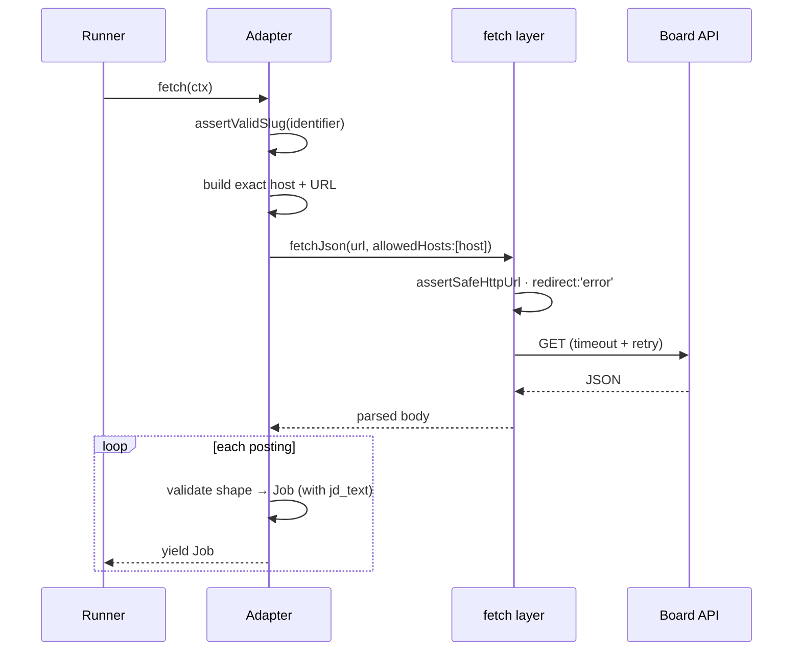

# Sources

A source is one place Lantern fetches jobs from. Every source is a public HTTP
API or feed, so there is no general web scraping in the default path. Adapters live
in [`src/sources/`](../src/sources) and are registered in
[`src/sources/index.ts`](../src/sources/index.ts).

## Two kinds of source

Sources come in two shapes, and the difference drives how a search reaches them.

| | Per-company board | Keyword aggregator |
|---|---|---|
| Needs a slug | Yes (the company's tenant) | No |
| Uses the search keyword | No, returns the whole board | Yes, the keyword drives the query |
| Example | `greenhouse:airbnb` | `remoteok` |
| Yields when keywords are empty | Still yields | Yields nothing |

Per-company boards return every open role for one employer; the criteria filter
narrows them afterward. Aggregators are keyword-global: they read the role terms
from the search and query the provider directly, so they contribute nothing to a
search with no title keywords.

## The adapter contract

An adapter is an async iterable so the runner can stream jobs into SQLite without
buffering:

```ts
interface SourceAdapter {
  fetch(ctx: SourceContext): AsyncIterable<Job>;
  enrich?(job: Job, ctx: SourceContext): Promise<Partial<Job> | null>;
}
```

`SourceContext` carries what the adapter needs from the current search: the source
config, the criteria-derived `keywords` and `locations`, whether remote is
required, `maxAgeDays` (the freshness window in days when the freshness gate is on,
otherwise undefined — for APIs with a recency filter, such as LinkedIn's `f_TPR`),
a progress callback, and an abort signal. The runner normalizes `keywords` before
handing them over: trimmed, lowercased, deduplicated, and with any keyword that
contains another as whole words dropped ("flutter developer" next to "flutter").

What the runner does around an adapter:

- **Per-source deadline.** Each source gets its own abort signal and an 8-minute
  deadline covering fetch and enrichment. On timeout the signal fires, the source
  is marked `last_status = 'timeout'`, and the scan moves on. Long paginated
  fetches should check `ctx.abortSignal` between pages.
- **Contract validation.** Every yielded job is checked against `JobShape`
  (`src/core/job.ts`). A job that fails (for example an empty URL or title) is
  skipped and counted in the source's `source_done` message, never stored.
- **Enrichment.** `enrich` is optional, for detail that costs one request per job
  (LinkedIn's JD). The runner calls it only for jobs that passed L1 and have no
  `jd_text` (and no JD already stored for that URL), sequentially, up to 40 calls
  per source per run, and merges the returned patch before storing. It should
  return null rather than throw on its own fetch failures; a throw is logged and
  treated as null. Per-run state such as a circuit breaker must be reset at the
  top of `fetch()`, since adapters are long-lived singletons.

Four rules are load-bearing (the full list is in
[`.claude/rules/source-adapters.md`](../.claude/rules/source-adapters.md)):

1. **Keep the SSRF guard.** Validate the slug, build the exact host, and pass it
   as an allowlist. Never fetch a user-supplied URL unguarded.
2. **Stream, don't buffer.** Yield `Job` objects; do not return an array.
3. **Populate `jd_text`.** The grader reads the description. If an adapter cannot
   fetch one, it leaves `jd_text` absent (NULL) rather than empty. An empty
   string reads as "no description" to the ghost scorer.
4. **Validate every parsed shape** against the contract, and keep the parse
   function exported and unit-tested next to the adapter.

### How a per-company fetch stays safe



The fetch layer ([`src/core/fetch.ts`](../src/core/fetch.ts)) centralizes the
guard. `fetchJson` / `fetchText` reject unsafe hosts, refuse redirects, and carry
timeout and retry knobs (retrying network errors, 429, and 5xx while respecting
`Retry-After`; guard rejections are never retried).

## The catalog

Per-company boards (each needs a slug in [`seed-sources.yml`](../src/config/seed-sources.yml)):

| Type | Provider | Salary | Description |
|---|---|:---:|:---:|
| `greenhouse` | Greenhouse | sometimes | via `?content=true` |
| `ashby` | Ashby | ✓ | structured comp |
| `lever` | Lever | ✓ | description + `lists[]` sections + additional |
| `recruitee` | Recruitee | — | ✓ |
| `smartrecruiters` | SmartRecruiters | ✓ yearly, when published | per-job detail via `enrich` (links are `jobs.smartrecruiters.com/{company}/{postingId}`) |
| `workable` | Workable | listing column, clean ranges only | per-job detail via `enrich` (`/api/v2/accounts/{slug}/jobs/{shortcode}`) |
| `personio` | Personio | — | ✓ |
| `bamboohr` | BambooHR | — | per-job detail |
| `breezy` | Breezy HR | free-text yearly only | ✓ (`?verbose=true`, one call) |
| `rippling` | Rippling ATS | ✓ yearly ranges | per-job detail via `enrich` (L1 survivors only) |
| `teamtailor` | Teamtailor | — | ✓ (RSS; `{slug}.teamtailor.com` hosts only) |
| `workday` | Workday | — | per-job cxs detail via `enrich` (composite tenant + site; `total` only on page 0) |

Keyword aggregators:

| Type | Provider | Auth | Default |
|---|---|---|:---:|
| `remoteok` | RemoteOK | keyless | on |
| `arbeitnow` | Arbeitnow | keyless | on |
| `himalayas` | Himalayas | keyless | on |
| `jobicy` | Jobicy (remote) | keyless | on |
| `themuse` | The Muse | keyless (keywords map to Muse categories, remote only) | on |
| `smartrecruiters_search` | SmartRecruiters cross-tenant search | keyless (newest 100 per keyword, JD via `enrich`) | on |
| `workingnomads` | Working Nomads | keyless | on |
| `weworkremotely` | We Work Remotely | keyless (category RSS) | on |
| `remotive` | Remotive | keyless, ~4 calls/day budget, attribution | off |
| `jobtech` | JobTech (Sweden) | keyless (Arbetsförmedlingen, Swedish postings, newest 300 per keyword, no salary) | on |
| `hn_hiring` | HN Who is hiring | keyless (latest two monthly threads, pipe-header parsing, ~3 calls) | on |
| `linkedin` | LinkedIn guest | keyless, gated (JD via `enrich`) | off |
| `google_jobs` | Google Jobs (SerpAPI) | API key | off |

Lantern ships around 320 seeded per-company boards, weighted toward Greenhouse
and Ashby, so a fresh install has coverage on the first scan. The seed list is a
maintained default (you are not expected to edit it), and boards seed lazily the
first time you run a scan.

A per-company entry marked `enabled: false` in the seed list is a board the
maintainers have retired (its slug 404s). Seeding is `INSERT OR IGNORE`, plus a
one-directional sync: such an entry turns the matching row off on the next scan.
The sync never turns anything on, and it skips keyword aggregators, whose
`enabled: false` means "opt-in", not "retired".

Three sources are held back by default. `linkedin` uses an unofficial keyless guest
endpoint (gray-area, aggressively rate-limited), `google_jobs` needs your own
SerpAPI key, and `remotive` is opt-in because its API terms allow about four calls
a day and require attribution (the adapter spends a persisted rolling-24h budget
and links back to Remotive). All three are enabled from Settings. The API never echoes a stored
`apiKey` back: `config_json` in responses carries a masked `••••` + last-four
value, and saving the masked value keeps the stored key.

Deleting a source from Settings turns it off instead when it still has saved jobs
or is a seeded default (which would just be re-added on the next scan).

## Discovered boards

Beyond the curated seed list, Lantern ships a second, machine-generated list of
about 15,500 per-company boards in
[`discovered-sources.json`](../src/config/discovered-sources.json). They are
**off by default**: they seed as disabled rows (`sources.origin = 'discovered'`),
stay out of the Settings roster, and turn on and off together with the
"Include discovered boards" switch in Settings (`PUT /api/sources/discovered`).
Turning them on starts the **background refresher** (Settings, "Keep boards fresh in
background", on by default), which warms them 3 at a time with per-host pacing. The
first full pass over all of them takes one to three hours (about 100 minutes in a
live test), and a search that starts sooner fetches whatever is not warm yet. Boards
fetched within the **board cache** window (Settings, default 6 hours) are re-checked
from their stored jobs instead of fetched again, and the refresher keeps them inside
that window between searches. The switch
works before the first scan: the Settings count and the toggle seed the rows from
the file on demand. To keep a scan across that many boards bounded, L2 grades at
most the **grading limit** (Settings, default 300) best-ranked survivors per
search. The rest stay ungraded ("N more not yet graded" on the Jobs page and in the
final progress message) and an identical re-search grades the next batch.

Seeding follows the same rules as the curated list, minus the retire sync: rows
are `INSERT OR IGNORE`d, an existing row is never touched, nothing is ever
turned on by the sync, and a board dropping out of the file leaves its row
alone. The whole seeding runs in one transaction, and the discovered part is
skipped while the file's content hash matches the one stored in settings. A slug
that later lands in `seed-sources.yml` adopts the row (origin cleared, enabled).
Adding a discovered board yourself through the API adopts it the same way
(case-insensitively) instead of returning a conflict, and deleting one turns it
off (it would be re-seeded).

### How the list is made

`bun scripts/discover-boards.ts` (not imported by the server) runs three phases,
each resumable from checkpoints in `.discovery-cache/` (gitignored):

1. **Discover.** Lists tenant URLs in [Common Crawl](https://commoncrawl.org)'s
   URL index for each ATS host (`boards.greenhouse.io`, `jobs.ashbyhq.com`,
   `{slug}.recruitee.com`, ...) across the latest crawls (`--crawls`, default 2, re-listed on every run so a newer crawl is picked up), and extracts the
   tenant slug with strict per-host patterns (exact host, one DNS label for
   subdomain styles, locale segments skipped, reserved names such as `www`/`api`
   and file-like segments dropped, `assertValidSlug` on every slug). Candidates
   already in the seed list are dropped. The default `--cdx-source bulk` reads the
   index from `data.commoncrawl.org` (one cached `cluster.idx` per crawl plus one
   ranged GET per ~3,000 records). `--cdx-source index` uses the public CDX server
   instead, which sheds load and has refused every connection for days at a time.
2. **Verify.** Every candidate is fetched live through its real source adapter
   (so "verified" means the scan code itself yielded at least one valid job),
   with at most 8 requests in flight overall and 4 per provider, plus a small
   delay. Boards that return no open jobs, a 4xx, a redirect to a custom domain,
   or a body past the size cap are dropped. Timeouts and 429/5xx are retried on
   the next run (`--per-type 1 --probe-delay-ms 700` for providers that rate
   limit, which Workable does). Results older than `--reverify-days` (default 30)
   are probed again, and a transient error never replaces an earlier real result.
3. **Write.** Verified boards, sorted by type and slug so regenerations diff
   cleanly, three fields per board (job counts and verification dates stay in the
   cache, since they would change every line on every run). The `generated` header
   records the crawl ids, the date and per-type candidate and verified counts.
   Only tenants the current extraction rules still produce are written.
   Display names come from the ATS where it exposes one cheaply (Greenhouse,
   Workable) and otherwise from the slug ("acme-corp" becomes "Acme Corp").

Useful flags: `--types ashby,lever`, `--crawls 2`, `--cap-per-type N`,
`--budget-minutes N` (stop verifying and write what is verified so far),
`--rediscover` (drop a type's cached slugs and page progress, needed after an
extraction-rule change), `--skip-cdx`, `--skip-verify`, `--write-only`.

Current list: crawls `CC-MAIN-2026-39` and `CC-MAIN-2026-34`, about 22,800
candidates after seed dedupe, 15,505 verified. Lever is sparse (22) because
`jobs.lever.co` is mostly absent from Common Crawl.

## Adding a board or a type

- **A new company on an existing type** is a one-line entry in
  `seed-sources.yml`, then a restart.
- **A new source type** touches several mirrors: the union in `src/core/job.ts`,
  the CHECK in `schema.sql` plus a rebuild migration, the type lists in
  `src/routes/sources.ts`, the registry in `src/sources/index.ts`, and the UI
  mirrors. See [development.md](development.md) for the full checklist.

For pasting a careers URL in the UI, `detectBoard` recognizes the common board
patterns and derives the type and slug from the URL.
